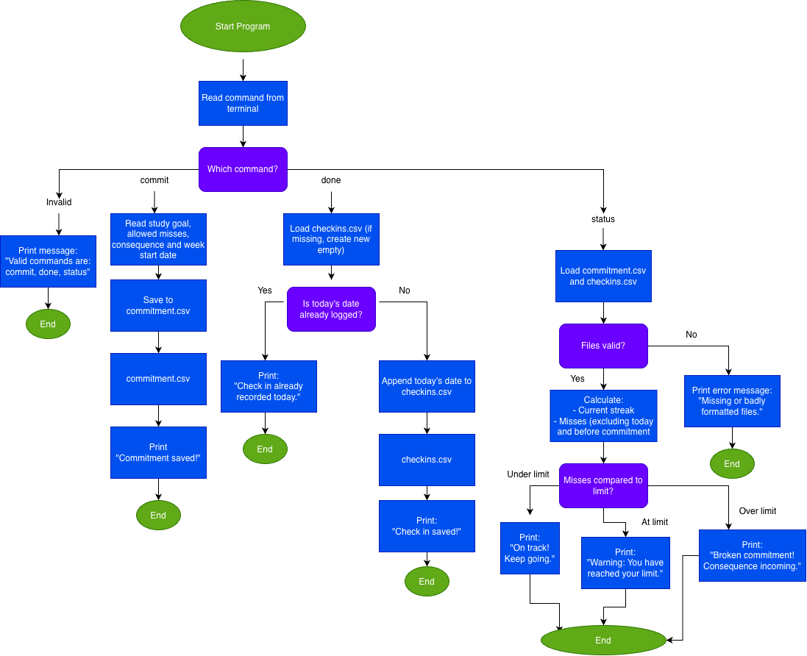

# Streak with Stakes

## Project Goal
Students trying to build a study habit often start strong, then fall off after missing a few days. Regular trackers only record a missed day, so skipping costs nothing. Streak with Stakes is a Java command-line tool that has you set a weekly study commitment with a personal consequence, then tracks your check-ins and tells you when you've broken it.

## MVP Scope
Version 1.0 will:

- Set a weekly study commitment with a daily study goal, allowed misses, and a consequence
- Check in for today and block duplicate check-ins
- Save and load data from CSV files
- Count misses and show the current streak
- Show the week's status, a warning at the miss limit, and a message when the commitment is broken

## Future Plans (V2.0+)

- Track multiple habits
- Send a daily reminder to study
- Keep history across weeks
- Show monthly stats and longest streak

## Tech Stack

- **Language:** Java
- **Libraries:** `java.time` and `java.nio.file` from the Java standard library, plus JUnit for tests
- **Data storage:** CSV files (`commitment.csv`, `checkins.csv`)
- **Data sources:** None; all input comes from the terminal
- **Tools:** VS Code, Git, GitHub, terminal

## Setup and Running

Requires Java 17 or newer (check with `java -version`).

```bash
git clone https://github.com/dhruvm20/streaks-with-stakes.git
cd streaks-with-stakes
javac -d out src/*.java
java -cp out StreakWithStakes help
```

## Roadmap
- [x] Set up repo, folder structure, and README
- [x] Read command from terminal and print usage for invalid input
- [x] `commit` saves the weekly rule to commitment.csv
- [x] `done` saves today's date to checkins.csv
- [x] Load saved data at startup and block duplicate check-ins
- [x] Calculate and display the current streak
- [x] Count misses and display weekly status
- [ ] Show limit warning and broken-commitment message
- [ ] Handle missing or bad files, and add JUnit tests

## System Diagram


## Eisenhower Matrix
[View the Eisenhower Matrix](docs/Eisenhower_Matrix_Streak_with_Stakes.pdf)
